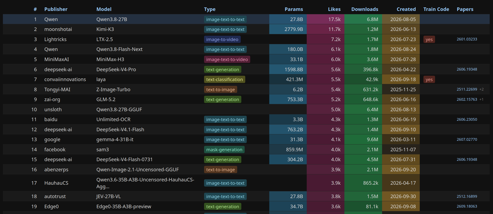

# Hugging Face top models '26

**Live: https://franciscocarloserra.github.io/hf-top-models/**

The 300 most-liked models on Hugging Face created in the last year, in a sortable table: type, params, likes, downloads, papers, and whether the model card links training code.

Click a column header to sort. First click sorts, second flips, third removes. Publisher, type and train code stack as groups, so Type → Likes ranks within each type. Click `#` to reset.

## Run

    python3 fetch.py                 # refresh data/models.json
    python3 -m http.server           # open http://localhost:8000

**Respect the Hugging Face API rate limits** (https://huggingface.co/docs/hub/rate-limits). `fetch.py` makes a few paginated calls; run it occasionally, not in a loop.

## Caveats

- Downloads are the last 30 days as reported by HF. Repos without a recognized weights/config file show 0 even if people download them.
- Params come from safetensors metadata; GGUF-only repos have none.
- `data/train_code.txt` is a hand-checked list of models whose card links training or fine-tuning code. It is not scraped automatically.
- Papers are the `arxiv:` tags HF extracts from the card.
